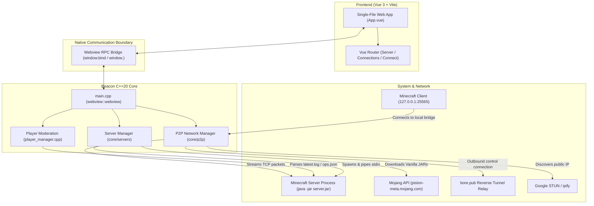

# Beacon

Beacon is a personal desktop Minecraft server manager and peer-to-peer multiplayer tunneling client. It combines a lightweight C++20 core with an embedded Vue 3 / TypeScript user interface rendered inside a native desktop Webview window (WebKit on macOS, WebView2 on Windows).

Beacon is designed for local instance management and quick, zero-configuration multiplayer hosting with friends without requiring manual router port forwarding or third-party cloud accounts.

> [!NOTE]
> Beacon is an active personal development project. It is not designed or audited as an enterprise, cloud-hosted, or multi-tenant server panel.

---

## Features

### Implemented Functionality

- **Vanilla Server Provisioning:** Automatically fetches version manifests and downloads official Minecraft server JARs from Mojang's API (`piston-meta.mojang.com`) into a local cache.
- **Instance Isolation & Configuration:** Allocates distinct instance directories under `Resources/servers/<uuid>`, manages `server.properties`, automatically accepts Mojang's EULA (`eula=true`), and links server binaries.
- **Process Lifecycle Management:** Spawns and manages server instances via `boost::process` with configurable memory flags (`-Xms1G -Xmx<N>G`), binds process standard input for commands, and executes graceful shutdowns via `stop` with timeout enforcement.
- **Interactive Server Console:** Reads real-time server output from `logs/latest.log` and pipes operator commands directly into the running server process standard input.
- **Player Tracking & In-Game Moderation:** Tracks active online players by monitoring `latest.log`, `ops.json`, `usercache.json`, and `banned-players.json`. Displays player skins via `mc-heads.net`, toggles operator privileges (`op`/`deop`), and issues kicks/bans with custom reason input modals.
- **P2P Multiplayer Hosting (`/connections`):**
  - **Zero-Account Reverse Tunneling:** Establishes an outbound TCP tunnel via public `bore.pub` relays (`bore.pub:7835` / fallback `159.223.110.159`).
  - **Local UPnP Port Mapping:** Queries Internet Gateway Devices via SSDP discovery and SOAP requests (`WANIPConnection` / `WANPPPConnection`) to attempt router port forwarding.
  - **Public Endpoint Discovery:** Detects public IPs via STUN (`stun.l.google.com:19302`) with HTTP fallback (`api.ipify.org`).
  - **Self-Contained Room Codes:** Encodes tunnel and direct endpoints into hex-based room codes (`BCN-XXXX-XXXX-XXXX`) and LAN codes.
- **P2P Multiplayer Joining (`/connect`):** Resolves room codes or direct host addresses and runs an internal local TCP proxy listener (`127.0.0.1:25565` or next free port) that streams client packets directly to the host session over TCP.

### Experimental, Incomplete, or Planned

- **Alternative Server Modloaders (Paper, Fabric, Forge):** Modloader options appear in the UI and data types, but automated downloading is currently restricted to Vanilla in code; non-Vanilla options throw a runtime exception pending implementation.
- **Detailed System Telemetry:** Basic server state (`RUNNING` vs `OFFLINE`) is tracked from process execution and local port probing; CPU/RAM utilization graphs are not yet implemented.
- **Linux Packaging:** CI automation packages macOS and Windows binaries; Linux builds are not currently configured or tested in GitHub Actions.
- **Legacy UI Stubs:** Views for authentication, general settings, and Docker container management exist in the repository as unused templates or inactive routes from earlier prototypes.

---

## Architecture

Beacon embeds a compiled single-file Vue application directly into the compiled C++ binary, eliminating the need to run an internal HTTP server or manage separate frontend assets at runtime.



### Communication Boundary

1. **Asset Embedding:** `interface2` is compiled using Vite with `vite-plugin-singlefile`. A post-build script (`interface2/postbuild.js`) transforms `dist/index.html` into a C++ header (`interface2/dist/index_html.h`) containing a raw byte array (`INDEX_HTML_BYTES`).
2. **Webview Engine:** `main.cpp` initializes a native webview window (1280x720) using `webview/webview` and loads the embedded HTML string into the view.
3. **RPC Bindings:** The C++ backend registers handlers via `main_window.bind(...)`. The Vue frontend executes calls through `window.<methodName>(...)` with JSON-serialized parameters and receives JSON responses.

---

## Prerequisites

### Supported Platforms

- **macOS (CI-tested):** Apple Silicon (`arm64`, macOS 14+) and Intel (`x86_64`, macOS 15).
- **Windows (CI-tested):** Windows 10 / 11 (`x64`, MSVC).
- **Linux:** Intended support, but not currently tested or packaged in CI.

### Build Tools & Dependencies

- **CMake:** Version 3.16 or higher.
- **C++ Compiler:** C++20-compliant compiler (Clang/AppleClang, MSVC 19.30+, or GCC 11+).
- **Build System:** Ninja (recommended) or platform-native generators.
- **Node.js & npm:** Node.js `^20.19.0 || >=22.12.0` (Node.js 22 used in CI).
- **Boost:** Version 1.83.0 or higher (`Boost::filesystem`, `Boost::headers`, and `boost/process`).
- **Webview Runtime:** Native WebKit on macOS (pre-installed) or Microsoft Edge WebView2 Runtime on Windows (pre-installed on modern Windows versions).
- **Automatically Fetched Dependencies (CMake FetchContent):**
  - [webview/webview](https://github.com/webview/webview) (v0.12.0)
  - [nlohmann/json](https://github.com/nlohmann/json) (v3.12.0)
  - [libcpr/cpr](https://github.com/libcpr/cpr) (v1.11.1)

### Minecraft Runtime Requirement

A compatible Java Runtime Environment (JRE/JDK) must be installed and accessible on your system `PATH` as `java`:
- Minecraft 1.20.1+ requires **Java 17** or higher (Java 21 recommended).
- Verify in your terminal:
  ```sh
  java -version
  ```

---

## Getting Started

### Option 1: Running Prebuilt Releases

1. Download the release archive for your platform from GitHub Releases or workflow artifacts (`Beacon-macos-arm64.zip`, `Beacon-macos-x86_64.zip`, or `Beacon-windows-x64.zip`).
2. Extract the archive. Ensure the `Resources` directory containing `db.json` is located in the working directory alongside the executable.
3. Launch the application:
   - **macOS:**
     ```sh
     chmod +x Beacon
     ./Beacon
     ```
   - **Windows:** Double-click `Beacon.exe` or execute `.\Beacon.exe` from PowerShell.

### Option 2: Building From Source

#### 1. Clone the Repository

```sh
git clone https://github.com/<owner>/Beacon.git
cd Beacon
```

#### 2. Build the Frontend Assets

Compile the Vue 3 single-file bundle and generate the C++ asset header:

```sh
cd interface2
npm install
npm run build
cd ..
```

*Verification: Ensure `interface2/dist/index_html.h` was created.*

#### 3. Configure and Build the C++ Binary

##### macOS

```sh
# Install dependencies via Homebrew
brew install boost ninja

# Configure and compile
cmake -B build -G Ninja -DCMAKE_BUILD_TYPE=Release
cmake --build build --config Release
```

##### Windows (Visual Studio / MSVC x64)

```powershell
# In an x64 Native Tools Command Prompt or PowerShell:
cmake -B build -A x64 -DCMAKE_BUILD_TYPE=Release -DBoost_ROOT="C:\local\boost_1_83_0"
cmake --build build --config Release
```

#### 4. Prepare the Local Database & Run

Beacon stores server definitions in `Resources/db.json` (or `resources/db.json` on Windows) relative to the launch directory:

```sh
# Create initial database file if not present
mkdir -p Resources
echo "[]" > Resources/db.json

# Launch the executable
./build/Beacon2_0
```

---

## Basic Usage

### Adding and Managing a Server

1. Navigate to **Server** in the sidebar.
2. Click **Create Server** (`+`).
3. Set your server name, select an official Vanilla version (e.g., `1.20.1`), allocate RAM (in GB), and choose a port (default: `25565`). Keep provider set to **Vanilla**.
4. Click **Create**. Beacon downloads the official server JAR from Mojang, creates `Resources/servers/<uuid>/`, populates `server.properties`, and sets `eula=true`.
5. Click **Start** to launch the instance.

### Viewing Logs and Moderating Players

- **Console:** Select your running server and switch to the **Console** tab to view output from `logs/latest.log` and send commands (e.g. `gamemode creative <player>`, `say Welcome!`).
- **Players:** Switch to the **Players** tab to view connected players. Use the action buttons to grant/revoke operator status (`op`/`deop`), or open the moderation modal to kick or ban a player with an optional reason.

### Hosting a Multiplayer Session

1. Start your local Minecraft server from the Server dashboard.
2. Navigate to **Connections** in the sidebar.
3. Click **Start Hosting**.
4. Beacon checks that the local server is listening on its port, requests a port mapping via UPnP, and connects an outbound reverse tunnel to `bore.pub`.
5. Copy the generated **Room Code** (`BCN-XXXX-XXXX-XXXX`) or **LAN Code** and share it with your friends.

> [!WARNING]
> If your Minecraft server is not running or listening locally when you click **Start Hosting**, the host session will fail with `SERVER RESPONSE FAILED`.

### Joining a Multiplayer Session

1. In Beacon, navigate to **Connect** in the sidebar.
2. Paste the host's Room Code (e.g., `BCN-XXXX-XXXX-XXXX`) or direct `host:port` address and click **Connect**.
3. Beacon establishes a background connection and opens a local bridge listener on `127.0.0.1:25565` (or the next available port).
4. Open Minecraft, navigate to **Multiplayer** -> **Direct Connection**, and enter:
   ```text
   127.0.0.1:25565
   ```
   *(or `localhost`)*

---

## Development and Testing

### Frontend Development

You can run Vite's standalone development server to inspect UI components in your browser:

```sh
cd interface2
npm run dev
```

> [!NOTE]
> Native backend operations (such as `window.startServer` or `window.startP2PHost`) are bound at runtime by the C++ webview. When running in a standard web browser, native IPC calls are not available unless mocked.

### Testing Status

- **Automated Tests:** There is currently no active automated CTest or Vitest test suite configured in CMake or CI.
- **Manual Verification:** Build the complete binary and verify:
  1. Creation and downloading of a Vanilla server instance.
  2. Process spawning and log streaming in the console.
  3. Tunnel negotiation and local proxy binding through the Connections and Connect tabs.

---

## Release Pipeline

GitHub Actions automation is defined in [`.github/workflows/build.yml`](file:///.github/workflows/build.yml).

### Workflow Triggers

- Pushes to branches: `main`, `clean-up`, `p2p-multiplayer`, `beacon-cpp`
- Pushes to version tags: `v*`
- Pull requests targeting: `main`
- Manual dispatch via `workflow_dispatch`

### Build Matrix & Artifacts

The workflow builds binaries across three runners:
- `macos-latest` -> `Beacon-macos-arm64.zip`
- `macos-15-intel` -> `Beacon-macos-x86_64.zip`
- `windows-latest` -> `Beacon-windows-x64.zip`

Each archive packages the platform executable alongside an initialized `Resources/db.json` file.

### Automated Releases

The `publish` job triggers automatically under two conditions:
1. **Push to `beacon-cpp` branch:** Publishes a GitHub Prerelease tagged `snapshot-<run_number>` named `Beacon snapshot <run_number>`.
2. **Push to a `v*` tag (e.g. `v1.0.0`):** Publishes a full GitHub Release tagged `v*` named `v*`.

---

## Repository Layout

```text
Beacon/
├── CMakeLists.txt                # Root CMake build configuration and dependencies
├── main.cpp                      # Webview initialization and native IPC bindings
├── toolchain-windows.cmake       # MinGW cross-compilation toolchain definition
├── .github/
│   └── workflows/
│       └── build.yml             # Matrix build, packaging, and release automation
├── core/
│   ├── containers/               # Server instance directory and file provisioning
│   │   ├── container.h
│   │   └── containers.cpp
│   ├── p2p/                      # P2P tunneling, UPnP, STUN, and local TCP proxy
│   │   ├── p2p_manager.h
│   │   └── p2p_manager.cpp
│   ├── servers/                  # Process lifecycle, log stream, player management
│   │   ├── add_server.cpp
│   │   ├── delete_server.cpp
│   │   ├── get_servers.cpp
│   │   ├── player_manager.cpp
│   │   ├── serverEntity.h
│   │   ├── servers.h
│   │   └── start_server.cpp
│   └── utils/                    # Mojang manifest fetching and jar downloaders
│       ├── utils.h
│       └── utils.cpp
├── interface2/                   # Vue 3 / TypeScript frontend
│   ├── package.json
│   ├── vite.config.js            # Single-file HTML compilation config
│   ├── postbuild.js              # Generates dist/index_html.h C++ byte header
│   └── src/
│       ├── App.vue               # Main application container
│       ├── Pages/
│       │   ├── dashboard/        # Server listing, creation, and console view
│       │   ├── connections/      # P2P host session view
│       │   └── connect/          # P2P join session view
│       ├── UI/                   # Reusable components and sidebar navigation
│       └── router/               # Hash-based view router
└── Resources/                    # Default runtime data directory
    ├── db.json                   # Server configuration database
    ├── cache/                    # Cached server JAR files
    └── servers/                  # Working directories for individual instances
```

---

## Known Limitations and Troubleshooting

- **`java` Not Found on `PATH`:** If the Minecraft server fails to launch immediately, ensure that Java is installed and `java` is resolvable from your terminal. Minecraft 1.20.1+ requires Java 17+.
- **Public Relay Availability:** WAN multiplayer sessions depend on outbound access to `bore.pub:7835` (or its fallback IP). If outbound traffic on port 7835 is blocked by a network firewall or if the public relay is offline, public tunnels cannot be established.
- **Unencrypted Public Relays:** Traffic routed through public relays is transmitted as raw Minecraft TCP packets. Any client with the assigned port can attempt to join the server. It is strongly recommended to enable a whitelist in `server.properties` or via the console (`whitelist on` and `whitelist add <player>`).
- **Port Conflicts on `25565`:** If port `25565` is already bound by another process or server on your machine, the client proxy automatically attempts to bind to the next available port (e.g. `25566` up to `25575`). Check the status indicator in the Connect tab and enter the assigned port in Minecraft.
- **Router UPnP Support:** UPnP port forwarding requires that your local network router supports UPnP IGD and has the feature enabled. If UPnP is disabled, Beacon continues to route internet traffic through the reverse tunnel.
- **Working Directory Context:** Beacon resolves the `Resources` directory relative to its current working directory. Launching the executable from outside the project directory without a `Resources/db.json` file in the current path will initialize an empty database.

---

## License and Contributions

- **License:** As of the current branch, this repository does not include a formal open-source license file. All rights are reserved by the repository owner unless otherwise stated.
- **Contributions:** This repository is maintained as a personal project under active development. Please consult with the maintainer prior to submitting significant pull requests.
